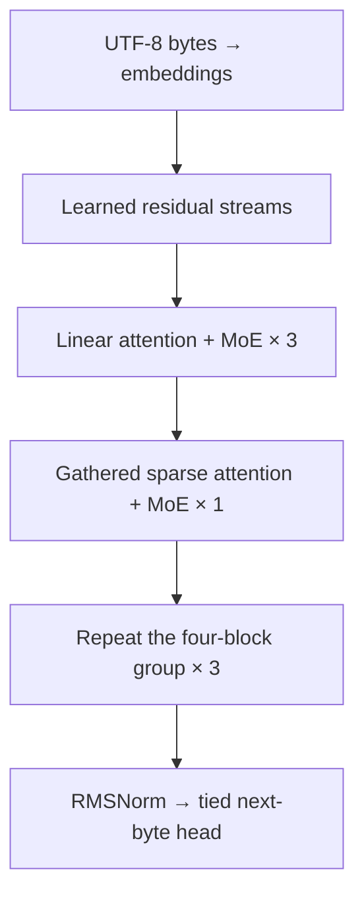

# README visual direction and image prompts

Use a readable educational/research identity: one understated banner, one exact architecture diagram, one measured quality-versus-time figure, and an optional expert-routing illustration. Keep screenshots/thumbnails/slides out. The reader should understand the experiment before noticing the decoration.

The inspiration is Vuk Rosić's architecture/execution narrative and modded-nanogpt's compact, evidence-led speedrun presentation. Develop your own identity rather than copying their branding or claiming their results.

## Visual system

- White/off-white figure backgrounds so chart labels survive GitHub light/dark themes. A dark banner can work independently.
- Blue `#2563EB`: hybrid reference. Teal `#0D9488`: real-token routing. Purple `#7C3AED`: chunked attention. Orange `#EA580C`: dense control. Red `#DC2626`: bias control. Cyan `#0891B2`: future-byte objective.
- Sans-serif labels, small monospaced configuration captions, generous whitespace.
- Banner: about 1600 × 480, displayed at full README width. Educational illustrations: about 1600 × 900. These are desired export dimensions; crop/resize after generation if the image tool returns a different size.
- Charts: use the script's PNG/SVG exports. Do not ask an image generator to redraw exact measurements, axes, error bars or empirical comparisons.

The following prompts are model-independent and can be pasted into your chosen GPT image interface (including the interface you refer to as GPT Images 2.0). They do not depend on an API/model identifier.

## Prompt 1 — Project banner

Save as `assets/illustrations/banner.png`. This is the first image to add.

> Create a wide, minimal GitHub repository banner for an independent educational LLM research project named “Modded-GLM”. Desired canvas 1600 × 480. Deep navy background #0B1220, precise restrained geometry, flat vector-like finish. On the right, a small stream of byte-sized tiles branches into four expert modules; exactly two routes glow teal while the remaining routes are subdued. A separate shared module suggests computation available to every token. Thin blue and violet lines hint at hybrid attention and residual streams without becoming a technical diagram. The left half has generous negative space for the title. Include only the title “Modded-GLM” and the smaller subtitle “Build. Measure. Improve.” Use crisp professional sans-serif typography. No speed numbers, loss values, GPU badges, leaderboard claims, robot, brain icon, circuit-board wallpaper, YouTube thumbnail styling, gradients obscuring labels or corporate logos. Strong silhouette, low visual density, elegant and readable at GitHub width.

If title lettering is imperfect, generate the background without text and add the exact title in an editor. The prose title remains in the README for accessibility.

## Prompt 2 — Expert routing intuition

Save as `assets/illustrations/expert-routing.png`, below the architecture explanation.

> Create a minimal educational illustration about a small Mixture-of-Experts language model. Wide 16:9 canvas, off-white background, thin navy outlines, teal/blue accents, very little text. One illustrative token represented as a small blue square enters a router. The router connects to exactly four specialist modules arranged as a compact two-by-two grid. Exactly two specialist paths are active teal; two inactive paths are light gray. A distinct shared expert sits alongside the specialist group and is connected for this token. The active specialist results and shared-expert result meet at one clean recombination junction and leave as a single output. No depiction of whole tokens being exclusively assigned to a single expert; two specialists must be selected. No measurements, percentages, performance comparisons, fake graphs or product logos. Labels only: “Router”, “4 routed experts”, “Top-2”, “Shared expert”, “Combine”. Make it warm, clear and memorable while remaining technically sober. This is a conceptual illustration rather than an exact implementation diagram.

Caption: “Each real token selects two routed experts and also passes through the shared expert. Conceptual illustration; weights and routing details are simplified.” Verify the generated topology before publishing.

## Prompt 3 — Hybrid attention rhythm

Save as `assets/illustrations/hybrid-rhythm.png`. Prefer an exact Mermaid/SVG diagram for the actual architecture; this is an optional conceptual companion.

> Create a sparse scientific editorial illustration of a repeating hybrid causal-attention rhythm. Desired 1600 × 700, white background, navy geometry, teal and purple accents. Show exactly four blocks in a single repeating motif: the first three are compact teal prefix-state modules, the fourth is a purple sparse-attention module. The prefix modules show a small compressed state advancing from left to right; the sparse module shows a local neighborhood and a few more distant causal connections. All arrows point forward in sequence order; no connection from a future position back into an earlier output. Label only “Linear”, “Linear”, “Linear”, “Sparse” and below the motif “Repeat × 3”. Leave large margins and avoid drawing a full 12-layer network. No claims that this is the frontier GLM model's exact kernel, no invented matrix values, no speedup arrows, no glowing chip photographs.

Caption: “The default 12-layer model repeats three linear-attention blocks followed by one gathered sparse-attention block. Educational approximation.”

## Prompt 4 — The experiment lab

Save as `assets/illustrations/experiment-lab.png`; optional below the community invitation. Skip if the README already has enough images.

> Create a playful but professional flat editorial illustration of an open LLM experiment lab. Off-white background, blue/teal/purple/orange palette, desired 1600 × 700. A small central model is surrounded by five distinct interchangeable experiment cards: token tiles with padded tiles faded; compact attention chunks; one dense module; balanced expert bins; a short sequence with two future positions highlighted. The cards are equally prominent; no card is declared the winner. The arrangement feels like a researcher comparing hypotheses, with clean lines, plenty of whitespace, no photograph, no humanoid robot and no clutter. Include only the headline “Five questions. One reproducible lab.” All smaller details use symbolic shapes rather than tiny illegible text. No fabricated benchmarks, rankings, improvement percentages, trophies or GPU performance claims.

Caption: “Five independently selectable experiments: routing, attention storage, dense controls, load balancing and future-byte objectives. Which help is a measurement question.”

## Prompt 5 — Community invitation strip

Save as `assets/illustrations/community.png`, optional above CONTRIBUTING links.

> Design a minimal wide research-community invitation strip, desired 1600 × 400. Deep navy background, sparse teal and blue geometric accents, crisp sans-serif typography. Several small distinct experiment paths converge into an organized stack of reproducible run receipts, represented as abstract paper cards without readable fake data. Include exactly this headline: “Your idea. Your run. A result others can reproduce.” The image should feel open and collaborative, suitable for a teenage aspiring researcher's public GitHub project. No leaderboard podium, record-time claims, invented institution affiliations, corporate logos or promotional urgency. Keep the title highly readable and the geometry secondary.

## Exact architecture diagram for GitHub

Use native Mermaid for the technical diagram. This diagram compresses the stream-mixing details; the full implementation is in DOCUMENTATION.md.



The repeating group labels describe the default configuration, not SDPA/dense variants. Future-byte heads are optional training auxiliaries and are omitted from this default inference diagram.

## Placement and captions

1. Banner immediately under the project title.
2. One-line purpose, author introduction, attribution and honest verification status.
3. Native architecture diagram in the architecture section.
4. Optional routing illustration beside/below the explanation.
5. Actual `validation-vs-time.png`, `peak-memory.png` and `expert-load.png` only after running the corresponding experiments. Start with the time/quality curve; show secondary charts only when they clarify the result.
6. Community invitation and CONTRIBUTING links, then the existing author/profile footer.

Do not add missing-image links in the live README. After saving the illustration:

```markdown

```

After running measured experiments, copy the selected exports:

```python
from pathlib import Path
import shutil
source = Path('runs/YOUR_CAMPAIGN/figures/group-0')
target = Path('assets/results')
target.mkdir(parents=True, exist_ok=True)
for name in ['validation-vs-time', 'peak-memory', 'expert-load']:
    for ext in ['png', 'svg']:
        shutil.copy2(source / f'{name}.{ext}', target / f'{name}.{ext}')
```

Replace YOUR_CAMPAIGN with the actual path; the notebook's timestamped figure directory differs. Then add:

```markdown


Measured on [GPU], PyTorch [version], FP32, batch [B], 320-byte context,
[step budget] steps, paired seeds [seeds], source [commit/hash]. Each line is one
run; time excludes validation and saving. Synthetic coding benchmark.
[Commands and receipts](PATH_TO_COMMITTED_RECEIPTS).
```

Replace every bracketed field before publishing. Commit the small receipt JSON/log evidence in a dedicated `records/` directory, not model weights. Never label one-seed screening curves as a confirmed win. Do not reuse the modded-nanogpt FineWeb loss threshold or compare your timing directly against its hardware benchmark.

References: [Vuk Rosić](https://github.com/vukrosic/glm-5.3-flash-from-scratch), [modded-nanogpt](https://github.com/kellerjordan/modded-nanogpt).
